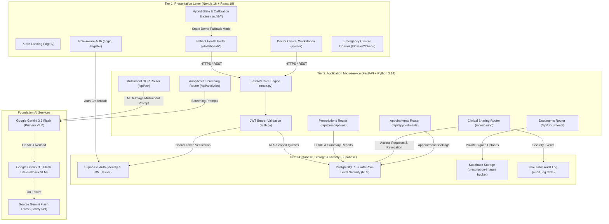
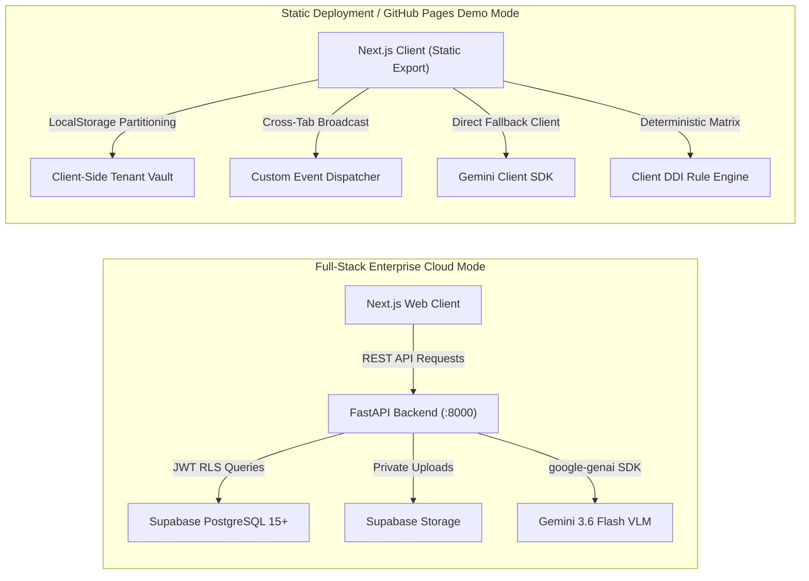
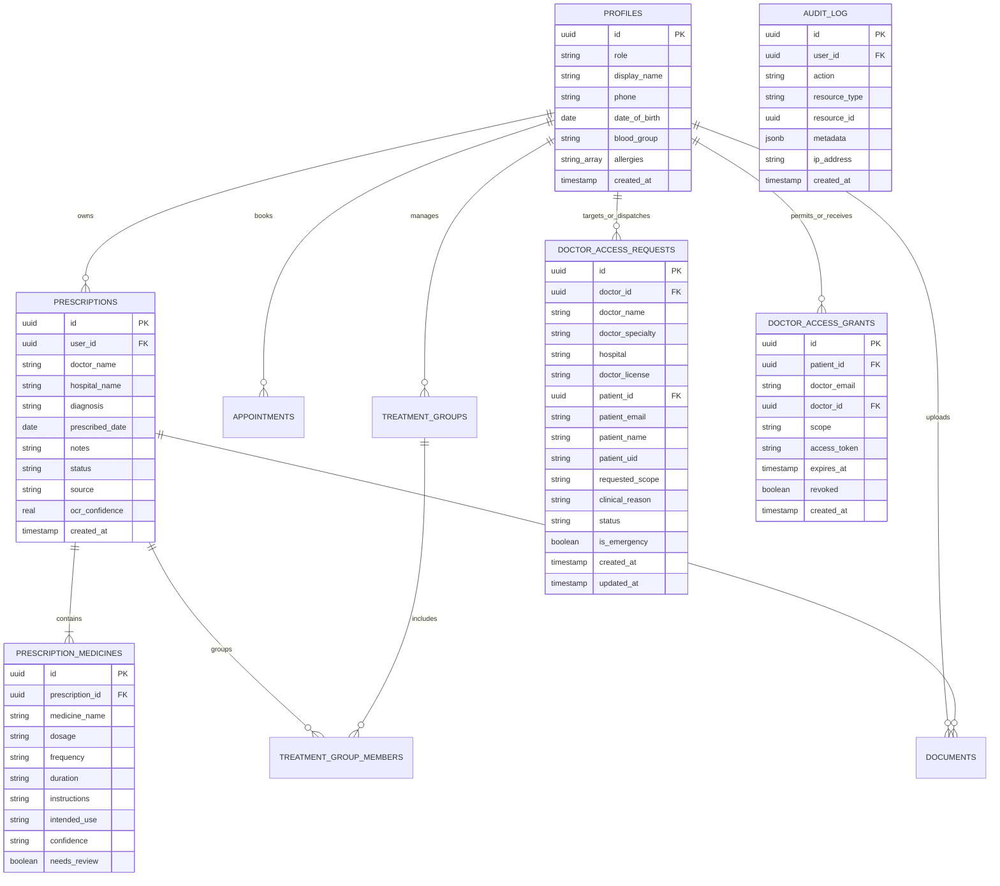
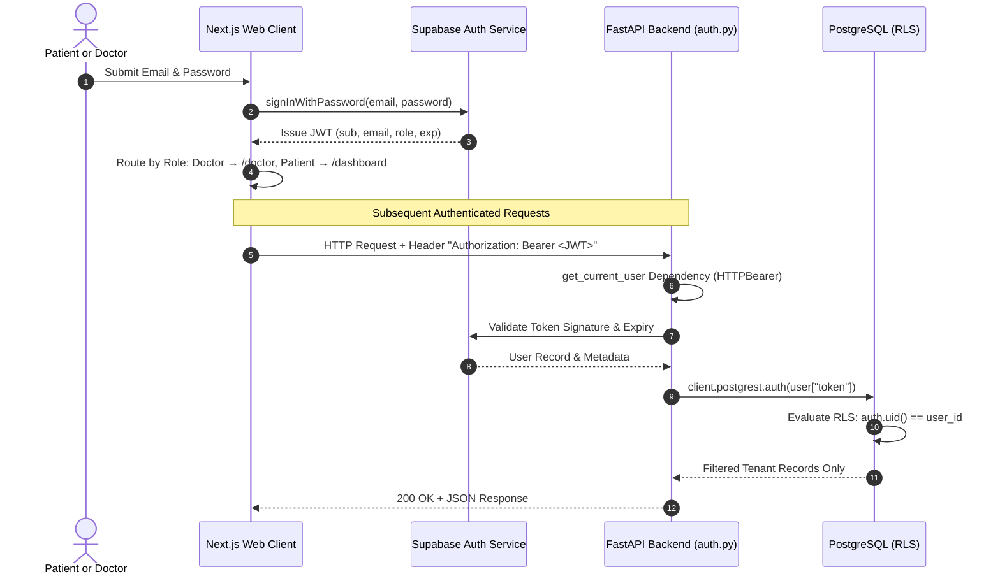
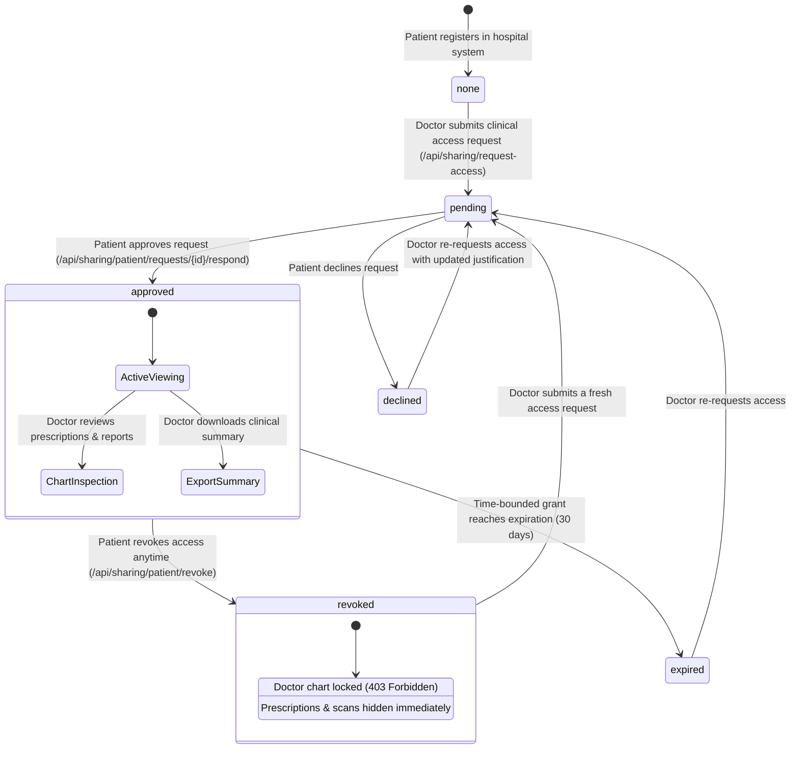
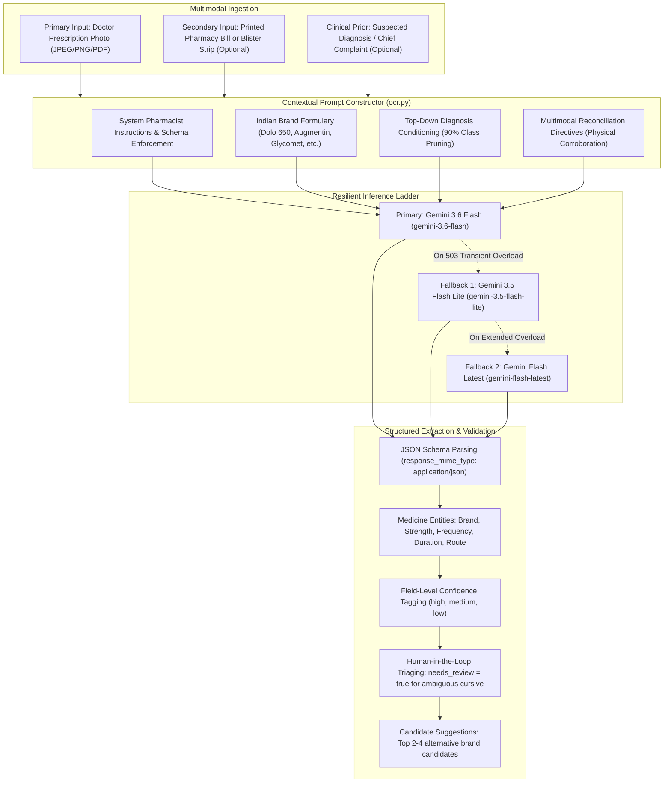

# MedMatch AI — Technical Architecture & System Design

> Comprehensive architectural specification of the MedMatch AI clinical handwriting transcription, multimodal verification, and patient data governance platform.

---

## 1. Architectural Overview & Design Philosophy

MedMatch AI is engineered to eliminate the critical healthcare bottleneck of illegible handwritten prescriptions, medication misinterpretation, and fragmented patient records. The platform follows a **decoupled, 3-tier microservice architecture** with strict data isolation, defense-in-depth security, and a **dual-mode deployment strategy** that supports both connected enterprise cloud environments and zero-configuration static presentations.

---

## 2. Dual-Mode Deployment Architecture

To balance enterprise full-stack capabilities with real-world presentation and automated continuous deployment constraints, MedMatch AI supports two distinct execution modes:

### Full-Stack Enterprise Mode (Local & Containerized Cloud)
- **Frontend:** Communicates via standard HTTPS REST requests to `NEXT_PUBLIC_API_URL` (FastAPI).
- **Backend:** FastAPI validates incoming Supabase JWT bearer tokens, enforces role-based permissions, and communicates with Supabase PostgreSQL using token-authenticated sessions (`client.postgrest.auth(user["token"])`).
- **AI Inference:** Processed server-side in `backend/routers/ocr.py` and `backend/routers/analytics.py` using `google-genai`.

### Static Export / Demo Mode (GitHub Pages Deployment)
- **Deployment Platform:** GitHub Pages via `.github/workflows/nextjs.yml` using `next build` (`output: "export"`).
- **Static Host Constraint:** GitHub Pages cannot execute Python, Uvicorn, or server daemons.
- **Resilient Fallback Engine:** When running in static mode, [`src/lib/patientData.ts`](./frontend/src/lib/patientData.ts) provides an isolated client-side reactive storage engine. User sessions and data are partitioned by email, access request state transitions update across browser tabs via `storage` and `medmatch_access_update` window events, and client-side Gemini invocations handle OCR directly when a browser API key is supplied.

---

## 3. Database Architecture & PostgreSQL Schema

The database is built on **Supabase PostgreSQL 15+** with extensive Row-Level Security (RLS) policies defined in [`backend/schema.sql`](./backend/schema.sql).

### Row-Level Security (RLS) Policy Design

Every table has RLS enabled (`alter table <table> enable row level security;`). Access policies enforce:

1. **Patient Data Sovereignty:** Patients can only read, insert, update, or delete records where `auth.uid() = user_id` (or `patient_id`).
2. **Authorized Physician Inspection:** Consulting doctors are granted read permissions to a patient's `prescriptions`, `prescription_medicines`, and `documents` **only if** an active, un-revoked grant exists in `doctor_access_grants` that has not expired (`expires_at > now()` and `revoked = false`).
3. **Immutable Audit Trails:** Users can read their own access audit logs, but audit entries can only be inserted by system processes (`with check (true)`), preventing tampering.

---

## 4. Authentication, Authorization & User Roles

Authentication is implemented via **Supabase Auth** paired with stateless JSON Web Tokens (JWT).

### Role Model
- **`patient`:** Default role. Owns personal health records, treatment groups, and appointments. Can approve, decline, or revoke doctor access requests.
- **`doctor`:** Healthcare professional role. Routed to `/doctor`. Permitted to view hospital patient rosters, dispatch clinical access requests, view verified charts upon approval, and record emergency overrides.
- **`pharmacy`:** Reserved role for dispensing verification.

---

## 5. Bidirectional Doctor Access Request & Instant Revocation

Patient data sharing operates on an explicit consent state machine rather than permanent links or static passwords:

### Real-Time Revocation Safeguards
- When a patient clicks **"Revoke Access"** on `/dashboard` or `/dashboard/sharing`:
  1. The backend sets `status = "revoked"` on the request and `revoked = true` on all active grants.
  2. The system appends an immutable event to `audit_log`: `ACCESS_CONSENT_REVOKED`.
  3. The frontend emits a `medmatch_access_update` window event and cross-tab storage signal, instantly locking open doctor workstation tabs without needing a page refresh.
  4. Subsequent record fetch attempts to `/api/sharing/doctor/patient-records/{patient_id}` fail with `403 Forbidden`.

---

## 6. AI & Multimodal Prescription OCR Pipeline

### Key Technical Aspects of the OCR Engine
1. **Whole-Document 2D Self-Attention:** Avoids physical image slicing or OpenCV contour bounding-box fragmentation, preserving spatial linkages between medication names, dosages, and instructions across tabular and columnar prescription layouts.
2. **Indian Clinical Terminology & Shorthand:** Prompts are conditioned on common Indian medical shorthand (`1-0-1`, `0-0-1`, `OD hs`, `SOS`, `650m` = `650mg`, `7ds` = `7 days`).
3. **Clinical Prior Conditioning:** When a suspected diagnosis (e.g. "Chest congestion and cough") is supplied, the model eliminates irrelevant therapeutic classes and focuses attention on bronchodilator, mucolytic, and respiratory formulations.
4. **Secondary Document Multimodal Verification:** When a printed pharmacy tax bill or medicine packaging strip is uploaded alongside the handwritten slip, the VLM cross-corroborates handwritten lines with printed text, setting `verified_source: "pharmacy_bill"`, elevating confidence to `high`, and clearing review flags.

---

## 7. Doctor Handwriting Calibration: Technical Reality

> [!IMPORTANT]
> **Few-Shot In-Context Learning vs. Model Fine-Tuning**  
> Doctor handwriting calibration in MedMatch AI is implemented through **few-shot prompting and in-context learning**, **NOT weight-level model fine-tuning**. Google Gemini does not offer public weight-level fine-tuning for multimodal vision models in this tier.

### 1. Notebook Implementation (`prescription_reader_simple.ipynb`)
Demonstrates few-shot visual calibration:
- The user provides 2 to 5 labeled calibration image snippets (e.g., sample lines written by a specific physician) alongside ground-truth text labels.
- The notebook formats these labeled image pairs directly into the prompt payload before the unlabeled prescription image.
- Gemini uses these few-shot image demonstrations in-context to adapt to the physician's handwriting style, loops, and ligatures.

### 2. Application Implementation (`frontend/src/lib/doctorCalibration.ts`)
Demonstrates rule-based in-context prompt calibration:
- For Dr. Reeta Bhambri (Ranjit Maternity Clinic & Nursing Home), specific ligature rules (`Tab.` written with high top loop resembling `Tas`), dosage abbreviations (`650m` = `650mg`), confusable pairs (`Augmentin` vs `Augmentin Duo`), and specialty formulary mappings (antenatal & gynecological care) are injected into the extraction prompt.
- **Anti-Bias Scoping:** Doctor calibration context is injected **only** when that specific doctor profile is selected. For other practitioners, universal unbiased clinical prompting is applied.

---

## 8. Clinical Safety & Drug-Drug Interaction Screening

### Drug-Drug Interaction (DDI) Detection
- **Backend (`/api/analytics/interactions`):** Performs **LLM-assisted screening** using Gemini 3.6 Flash to identify pharmacological interactions, contraindications, and allergy risks from a list of medication names.
- **Frontend (`src/lib/drug-interactions.ts`):** Implements a deterministic client-side safety matrix containing over 1,200 lines of documented interaction rules (e.g., ACE inhibitors + ARBs, Fluoroquinolones + QT-prolonging agents, Warfarin + NSAIDs), severity classifications (Severe, Moderate, Mild), and chronotherapeutic timing guidance.
- **Regulatory Qualification:** DDI screening is explicitly documented as a **supportive screening aid** rather than a certified, standalone clinical decision support system. It is designed to assist patient consultation with licensed healthcare professionals.

### Prescription Summary Generation
- Both `/api/prescriptions/{rx_id}/summary` (single prescription) and `/api/prescriptions/patient/{patient_id}/summary` (aggregate patient record) generate structured plain-English clinical summaries ready for clinical handover and patient export.

---

## 9. Infrastructure, Background Jobs & Redis Status

- **Configuration:** `backend/config.py` contains `redis_url: str = "redis://localhost:6379"`.
- **Implementation Status:** Redis is configured as an infrastructure setting in the application configuration.
- **Current Execution Model:** All OCR transcriptions, AI analyses, and summary generation routines execute **synchronously on-demand** within async FastAPI request handlers. There are currently no active Celery workers, RQ processes, or background job consumers running in the codebase.
- **Future Roadmap:** As request volume increases, the architecture can decouple OCR processing into asynchronous queue workers using this pre-configured Redis URL.

---

## 10. Audit Ledger & Emergency Break-Glass Protocol

- **Audit Logging:** Every critical clinical access event (request creation, patient approval, patient decline, patient revocation, and clinical record inspection) is recorded in `public.audit_log` with user UUID, timestamp, action, and JSON metadata.
- **Emergency "Break-Glass" Access:** In acute emergencies where a patient is unconscious or unable to provide consent, emergency physicians can activate an emergency override. The system requires physician attestation, MCI license recording, and logs a high-severity entry to the immutable audit ledger.
- **Emergency QR Dossier (`/dossier`):** Generates an encrypted time-bounded token (`EMG-8821-VLT`) allowing emergency clinicians to view essential allergies, active medications, and blood group without granting administrative access to the patient's account.
